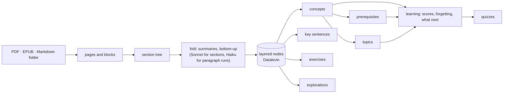

<p align="center">
  
</p>

<h1 align="center">Fly Learner</h1>

<p align="center">
  <b>Turn a book, a paper or a repository's docs into a map of what it knows, then learn it.</b>
</p>

<p align="center">
  <a href="LICENSE"></a>
  
  
</p>

Reading a long text word for word, you lose track of where you are and what it is for. Fly Learner reads it first.
It folds the source into layers, from a bird's-eye view down to the original paragraphs, finds the ideas it teaches
and what each one needs before it, and keeps the original beside you, page by page. Then it helps you learn: it asks
you questions, grades your answers, notices what you are forgetting, and tells you what to study next.

It is a personal tool. It runs on your machine, keeps everything in a local database, and calls Claude only to
read and to ask.

## What you can do

### Bring a source

- **PDF** papers and books: paragraphs rebuilt across page breaks and formulas, and chapters recovered from
  numbered headings even when the PDF has no outline.
- **EPUB** books, cut into pages of about a printed page each so they read like a PDF. Code and display formulas
  stay with their paragraph, and footnotes follow the paragraph that cites them.
- **A folder of Markdown**, such as a repository's `docs/`. It is read as a book:
  - The chapters follow the folder's own order: `docs.json`, `SUMMARY.md` (mdBook, GitBook) or front matter
    (`sidebar_position`, `weight`, Docusaurus `_category_` files).
  - Front matter adds titles, descriptions, tags, authors and dates, and drafts are left out.
  - TeX is typeset the way GitHub reads it (`$x^2$`, `$$…$$`, ```` ```math ````), and "costs $5 or $10" stays text.
  - Links between chapters go to their page, and links to the code they talk about open on GitHub at the commit
    you have.
  - `--skip Reference` leaves out a part you would rather look things up in than learn.

```sh
git clone --depth 1 --filter=blob:none --sparse https://github.com/owner/repo data/sources/repo
git -C data/sources/repo sparse-checkout set docs
bb ingest data/sources/repo/docs --outline          # chapters, pages and a cost estimate, no model calls
bb ingest data/sources/repo/docs --skip Reference
```

A source is its document, not its file. If you move it, rename it or fix a typo and ingest it again, it is the same
source, and your notes, bookmarks and progress stay with it.

### Read it as a map

- **Layers.** The book becomes a bird's-eye summary, then chapters, then sections, then passages, then the source
  paragraphs. Every layer has a title, a summary and keywords, so you can read a chapter from its outline and drill
  down only where you need to.
- **The source beside the text.** The PDF (drawn by pdf.js) or the book's own HTML pages sit in one scrolling
  column. The passage you are reading is highlighted on its page, and as you scroll the page, the text on the left
  follows.
- **Key sentences.** In every passage, the one to three sentences that carry it are tinted on the page, with a
  short label in the margin, so each page reads like an outline.
- **Your place.** Bookmarks take you back to where you were reading, and every node, concept and answer has its own
  URL.

### See what it knows

- **Concepts.** Keywords are resolved into concepts. Each has a label, a gloss that fixes its sense, the other
  names it goes by, and the broader concept it belongs to. Every concept page lists the passages that mention it,
  next to a graph you can expand one neighbour at a time.
- **What to learn first.** Prerequisites are judged for every concept, including background the sources assume but
  never teach. "Learn first" on a concept's page shows the path up to it, foundations first, and the graph draws it
  with arrows.
- **The map.** Concepts are grouped into topics by how they connect, whichever book they come from, and the model
  names each topic. The home page draws them as bubbles that fill as you learn them. Adding a new source never
  reshuffles the topics you already have.

### Ask

- **Ask the whole collection.** Answers come from your sources only (graph RAG over full-text search, the
  layers and keyword links), cite the passages they use, and come with the part of the book they are drawn from.
  About $0.001 a question.
- **Ask about a selection.** Select a sentence, or a formula on the PDF page, and ask "what does ι mean here?". The
  answer is grounded in that paragraph and its page, and any background the book never explains is marked as such.
  Keep the answer as a note if it helped.

### Learn and remember

- **Scores.** Each concept, and each relation between two concepts, has a score from 0 to 1, replayed from
  everything you have answered. Scores fade with time since you last recalled them (FSRS-style), so reviews come
  up on their own.
- **What to study next** weighs how important an item is, how much room you have to grow on it, and whether you
  know its prerequisites, so foundations come first. Choose a few topics to focus on, and the suggestions come from
  them.
- **Quizzes where you are.** "Quiz me" docks a question at the top of the left pane, beside the source, so you can
  read while you answer. You write a free-text answer, Sonnet grades it against key points and gives feedback, and
  you see how your scores moved.
- **The author's own exercises.** A book's exercises and their solutions are found, transcribed with their tables
  and formulas, and served as quizzes. They count double, are graded against the author's solution, and link back
  to their page.

### Explore by doing

For a passage that is easier to understand by playing with it, such as a game's payoffs, a reduction or a
recurrence, Fly Learner can build a small interactive page from the passage's own text: sliders, choices, tables,
plots, diagrams, step-throughs, and "predict first" questions. A page is data, drawn by the app and checked before it
is kept, so it is safe to open, and you can ask for it to be made again ("a 3×3 game").

### Write your own

- **Highlight, agree, disagree, restate.** Write a note on a concept, a relation, a passage or any sentence you
  select, in the text or on the page. Notes are Markdown with formulas.
- **Link your notes.** `[[a concept]]` links a concept, and `[[A]] needs [[B]]` says what comes first. What your
  notes say shows up on concept pages, and a term no source names becomes your own term, with a page of its own.
- **The notebook.** Everything you wrote, as a book of your own, arranged by source and chapter in reading order. You
  can download it as one Markdown file with the `[[links]]` kept.
- **Your notes never move your scores.** What you write and what you know are kept apart on purpose.

### Correct the model

The model makes mistakes, so you can fix its work. Add a concept it missed (it is found in every passage that
names it, and its prerequisites are judged). Remove a topic that is no knowledge, such as an edition's colophon, or a
concept that is not one. Merging, splitting and renaming concepts are there too, from the REPL. Every change is
logged, and an ingest never brings back what you removed.

## How it works



The code is in layers that know each other as little as possible, and an architecture test checks it:

- **Knowledge**: ingest, fold, concepts, prerequisites, topics, ask. It knows nothing of learning.
- **Learning** is pure. It states what it needs as protocols (a curriculum, a model of memory) and derives scores
  by replaying an evidence log. Forgetting is a model wrapping a model, and learning knows nothing of it.
- **Features** such as quizzes depend on learning only.
- **Ideas** (your notes) and **explorations** each have one bridge namespace to the knowledge, and none to
  learning.
- **The app** (server and UI) composes them.

Any of them can be rewritten without touching the others.

## What it costs

Measured on real sources, at list prices:

| Work | Cost |
| --- | --- |
| Fold a 116-page thesis into 1,052 nodes (68 s) | $0.23 |
| Resolve its 406 keywords into 209 concepts | $0.24 |
| Name 32 topics over 645 concepts | $0.05 |
| Key sentences for a textbook's 595 passages | $0.18 |
| Ask a question | ~$0.001 |
| Write and grade a quiz question | ~$0.005 |
| Make an interactive exploration | $0.04–0.05 |

`bb ingest --outline` estimates the fold before any model call, and every ingest prints what it spent.

## Getting started

You need [devenv](https://devenv.sh) (it brings the JDK, Clojure, Node and babashka) and an Anthropic API key, in
`ANTHROPIC_API_KEY` or in the macOS keychain item named in `resources/config.edn`.

```sh
devenv shell
bb install                     # npm packages; vendors pdf.js and KaTeX
bb dev                         # nREPL; in it, (user/cljs!) starts the app
open http://localhost:3000

bb ingest data/sources/book.pdf            # or .epub, or a folder of Markdown
```

`bb ingest` folds the source, then resolves its concepts, clusters topics, judges prerequisites, and finds key
sentences, exercises and passages worth exploring. With `bb dev` running, it works through that REPL (Datalevin wants
one writer), so reload the browser to see the result.

Other tasks: `bb serve` (a release build on :8080), `bb test` (Kaocha + Rich Comment Tests), `bb lint`.

## Built with

Clojure on the JVM and ClojureScript with [Replicant](https://github.com/cjohansen/replicant), a single pull-pattern
API ([lasagna-pattern](https://github.com/flybot-sg/lasagna-pattern), the stack of [flybot.sg](https://www.flybot.sg)),
[Datalevin](https://github.com/juji-io/datalevin), the Anthropic Java SDK, PDFBox and pdf.js, jsoup, commonmark-java,
KaTeX, and http-kit with [fun-map](https://github.com/robertluo/fun-map).

Folding a document into layers was inspired by [textfold](https://github.com/chenxiachan/textfold). The project is
developed with Claude Code and [clojure-mcp-light](https://github.com/bhauman/clojure-mcp-light).

## License

[MIT](LICENSE) © Luo Tian
